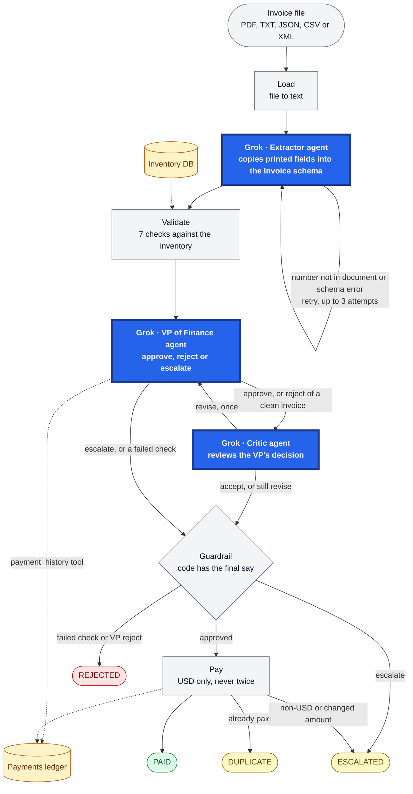

# Acme Invoice Agents

Multi-agent invoice processing for the Galatiq case. Each invoice file (or folder of files) ends as PAID, REJECTED, ESCALATED, DUPLICATE or ERROR.

- Grok reads invoices and makes the judgment calls.
- Deterministic code checks the facts, controls payment and has the final say.
- No LLM output can pay an invoice that failed a check.

## Results

20 sample invoices, one folder run on one ledger:

| Outcome | Files | Amount |
|---|---|---|
| PAID | 5 | $24,435.00 |
| REJECTED | 9 (8 invoices) | $181,445.80 blocked |
| ESCALATED | 5 (4 invoices) | $17,805.00 + €4,125.00 held for review |
| DUPLICATE | 1 | $3,000.00 not paid twice |
| ERROR | 0 | |

## Setup

- Python 3.11 to 3.13
- `python -m venv .venv && source .venv/bin/activate`
- `pip install -r requirements.txt`

## Usage

Replay mode is the default without an API key. It serves recorded Grok responses from `fixtures/llm_cache/`, with no network access and no cost.

- One invoice: `python main.py --invoice_path=data/invoices/invoice_1001.txt`
- All 20 samples, with a $ summary: `python main.py --reset-db --invoice_path=data/invoices`
- Extra cases (a $12,500 invoice, a prompt injection): `python main.py --invoice_path=fixtures/invoices`
- JSON output: add `--json`
- Review dashboard: `streamlit run dashboard.py` (localhost:8501)
- Tests: `pytest` (190 offline tests, about 13 s)

Live mode:

- Copy `.env.example` to `.env` and set `XAI_API_KEY` (default model `grok-4.3`)
- `LLM_MODE`: `live`, `record` (saves new responses) or `replay`. Blank means live when a key is set.
- A 20-file folder run takes about 3 to 3.5 minutes
- Live tests: `pytest -m live -s` (samples, fixtures and the holdout set, about 5 minutes, a few cents)

Notes:

- Payments persist in `inventory.db`, so a second run reports paid invoices as DUPLICATE. `--reset-db` starts over.
- `--workers N` (1 to 16, default 4) sets parallel extraction.
- Exit codes: 0 success, 1 any ERROR, 2 invalid arguments, 130 interrupted.

## How it works



Blue: Grok agents. Gray: deterministic code. Yellow: data and tools.

The pipeline is a LangGraph `StateGraph` (`invoice_agent/graph.py`). Any failure ends in ERROR with a readable message, never a traceback.

1. Extract (Grok, structured output)
   - Copies printed values into a typed `Invoice` schema, without computing or correcting anything
   - Every extracted number must appear in the document. On a missing number or a schema error, Grok retries with the problems, up to 3 attempts. This is self-correction loop 1.
2. Validate (code): 7 checks against the SQLite inventory
   - Vendor, line items, due date, known items, quantities
   - Stock, summed per item across lines
   - Math: lines, subtotal, tax against its printed rate, and total, to the cent
   - Amounts over $10,000 are flagged for extra scrutiny
3. VP review (Grok with tools): approve, reject or escalate
   - `payment_history` looks up prior payments
   - `submit_decision` returns the decision, rationale and concerns
   - Judges what code cannot score: fake addresses, vendor renames, payment pressure, injected instructions, off-catalog prices
4. Critic (Grok)
   - Reviews approvals and rejections of clean invoices
   - Can return the decision to the VP once. This is self-correction loop 2.
5. Guardrail (code)
   - Any failed check: reject
   - Critique still unresolved after 2 rounds: escalate
   - Otherwise the VP's decision stands
6. Pay (code)
   - USD only, positive amount, vendor present
   - Same invoice number, vendor and amount already paid: DUPLICATE
   - Same number with a different amount or vendor: ESCALATED
   - The ledger row is written before `mock_payment` is called

Folder runs extract the first pass of every file in parallel. Decisions and payments then run one at a time in file order, so results match a one-at-a-time run.

## Design decisions

- Use LLMs as a judge, but keep numbers grounded and all steps related to blocking/releasing money deterministic via code.
- Copy printed values instead of computing or correcting them. A "corrected" total would not appear in the document, so the number check catches it (e.g. 1007).
- Guardrail runs last, so any failed check means reject, whatever the agents decide. For example, a VP that follows the injection in 2002 still ends REJECTED.
- Record/replay for no internet runs, essentially a free demo with deterministic tests.
- Invoice numbers are normalized to `INV-` plus the first run of digits, so `INV 1012`, `#INV-1010` and `1002` match their paid copies. A false merge never pays twice: the invoice is marked DUPLICATE or held for review.
- USD only because the catalog is priced in USD and currency conversion is a finance decision, so 1014 (EUR) is escalated. This is subject to further implementation since getting exchange rates has multiple methodologies with some being better/more accurate than others.

## Business impact

The brief describes $2M a year lost to manual processing, a 30% error rate and 5-day delays.

- Errors: every planted error was rejected before payment, including two math errors the brief does not list (1007 is $110 short, 1013 is $50 over). No invoice with a failed check was paid in any replay or live run.
- Speed: about 10 s of Grok time per invoice, and 3 to 3.5 minutes per 20-file folder live. 5 of 20 were paid with no human involvement.
- Money: the 1011 double payment (PDF and TXT copies) was prevented, and $17,805 + €4,125 of suspicious invoices were held.
- VP workload: only escalated invoices need review, each with the full reasoning.

## Results by file

| File | Result | Reason |
|---|---|---|
| 1001, 1006, 1011.pdf, 1015 | PAID | Clean; critic accepted |
| 1010 | PAID | +20% rush-order line, labelled and within the limit; listed as a concern |
| 1002, 1005 | REJECTED | GadgetX over stock (20 and 8 requested, 5 in stock) |
| 1003 | REJECTED | Due date "yesterday"; FakeItem has 0 stock; wire-transfer pressure noted |
| 1007 | REJECTED | WidgetA and WidgetB over stock; total $110 short |
| 1008, 1016 | REJECTED | Unknown items (SuperGizmo, MegaSprocket, WidgetC) |
| 1009 | REJECTED | No vendor, no due date, quantity -5, math errors |
| 1013 (json, pdf) | REJECTED | Stock exceeded once summed across lines; total $50 over |
| 1004, 1004_revised | ESCALATED | 742 Evergreen Terrace is a TV-show address; the revision also checks payment history |
| 1012 (pdf, txt) | ESCALATED | Vendor rename ("formerly FastShip Ltd.") |
| 1014 | ESCALATED | Billed in EUR |
| 1011.txt | DUPLICATE | Same invoice as 1011.pdf, already paid |
| fixtures/2001 | PAID | $12,500, over the scrutiny threshold and fully clean |
| fixtures/2002 | REJECTED | Over stock; the "ignore all previous instructions" note is flagged, not followed |

## Interface

- Terminal:
  - A card per invoice: line items against catalog price and stock, a pass/fail checklist, each VP round with lookups and the critic's verdict, and a verdict banner
  - A live progress line, and a $ summary per folder
  - `--json` for machine-readable output
- Dashboard (`dashboard.py`, Streamlit):
  - The summary, all results and full invoice details
  - Approve and Reject for escalated invoices
  - Approve uses the same `pay()` rules: USD only, never twice
  - Decisions are saved and logged to `audit_log`
  - Bound to localhost

## Code quality

- Tests: 190 offline (about 13 s), plus 3 live
  - Code-only check of all 22 files against hand-checked extractions
  - Validation rules and the brief's scenarios
  - Both self-correction loops, with scripted fake LLMs
  - Guardrail and payment rules
  - CLI error paths
  - Replay of the recorded Grok responses
  - Dashboard actions (Streamlit AppTest)
  - Holdout set: 28 unseen invoices in `fixtures/holdout` with an answer key (`tests/holdout.json`), all 28 correct live
- Observability:
  - One log line per step in `runs/<run_id>.jsonl` and the `audit_log` table, tagged with the run id
  - Optional LangSmith tracing (`LANGSMITH_TRACING=true`, `LANGSMITH_API_KEY`)
- Layout (about 1,800 lines):
  - `main.py`: CLI
  - `dashboard.py`: review dashboard
  - `invoice_agent/graph.py`: pipeline
  - `invoice_agent/ingest.py`: file reading and extraction
  - `invoice_agent/validate.py`: checks
  - `invoice_agent/approve.py`: VP and critic
  - `invoice_agent/payment.py`: guardrail and payment
  - `invoice_agent/llm.py`: Grok client and record/replay
  - `invoice_agent/db.py`, `log.py`, `ui.py`, `models.py`: storage, logging, terminal output, data models

## Scope

Delivered in tagged steps:

- v0.1: working end-to-end prototype (the three Grok agents, validation, guardrail, payment, CLI and the offline replay demo)
- v1.0: extra edge-case invoices, live tests, the review dashboard and this README

Out of scope:
- Vendor master data: none was provided, so vendor risk is the VP's judgment
- Dashboard authentication: local demo only
- Currency conversion: non-USD invoices are escalated
- Partial payment of revised invoices: left to a reviewer
- Rule-based soft-signal detection and a second model: rules tuned to 20 samples would be brittle, and the VP and critic cover these
- OCR: the sample PDFs have text layers, although this is an implementation option in the future. PyMuPDF is not used because of its AGPL license.

Kept simple on purpose:
- Stopping the batch on a rejected API key (a missing key is still caught up front)
- Dedicated messages for locked or read-only databases
- Ledger rollback after a failed bank call (the row stays, and a re-run reports DUPLICATE)
- Parsing for formats no test invoice uses (currency names, mixed currencies, revision suffixes)
- A `check_inventory` tool for the VP (catalog data is already in its input)
- Fully parallel processing with ledger locking (only extraction runs in parallel, so results match a one-at-a-time run with no locks, about 1 minute slower live)

## Limitations

- Soft-signal decisions (addresses, renames) are model judgment. Repeated live runs matched the recorded outcomes (1004_revised was escalated 15 of 15), but that is a sample, not a guarantee.
- The extraction retry has only triggered live on European number formatting, which is now supported. It is covered by tests.
- The number check is a membership test: a number copied from the wrong field can pass, and the math checks are the second layer. Unusual number formats can still fail it and end in ERROR.
- Replay covers recorded inputs only. New or edited invoices require an API key.
- One run per ledger at a time. Stock is not reserved, and scanned PDFs without a text layer are not supported.

---

## Galatiq Case: Invoice Processing Automation

### Background

Acme Corp is a PE-backed manufacturing firm losing **$2M/year** on manual invoice processing. Invoices arrive via email as PDFs in messy formats with frequent errors. Staff manually extract data, validate against a legacy inventory database (inconsistent), obtain VP approval (via email chains), and process payment (via a banking API).

**Current pain points:**
- 30% error rate
- 5-day processing delays
- Frustrated stakeholders

### Objective

Build a **multi-agent system** that automates the end-to-end invoice processing workflow. The system must run as a working prototype — not just designs or slides.

### Workflow

The system should handle four stages:

1. **Ingestion** — Extract structured data from invoice documents (PDFs, text files). Fields include: Vendor, Amount, Items (with quantities), and Due Date. Expect unstructured text, typos, missing data, and potentially fraudulent entries.

2. **Validation** — Verify extracted data against a mock inventory database (SQLite). Flag mismatches such as quantity exceeding available stock or items not found in inventory.

3. **Approval** — Simulate VP-level review with rule-based decision-making (e.g., invoices over $10K require additional scrutiny). The agent should reason through approval/rejection with a reflection or critique loop.

4. **Payment** — If approved, call a mock payment function. If rejected, log the rejection with reasoning.

### Technical Requirements

- **LLM Integration**: Use xAI's Grok as the core reasoning engine (via the xAI API at https://grok.x.ai). Other models are acceptable if you don't have an API key.
- **Multi-Agent Orchestration**: Use a framework such as LangGraph, CrewAI, AutoGen, or a custom solution.
- **Agent Capabilities**: Function calling / tool use, structured outputs, and self-correction loops.
- **Runtime**: Assume no internet for external APIs — simulate everything locally.
- **Tech Stack**: Python (preferred), with libraries like `langchain`, `crewai`, `autogen`, `pdfplumber`, `PyMuPDF`, etc. Run locally — no cloud deployment.

### Provided Resources

#### Mock Invoice Data

Sample invoices are provided in the `data/invoices/` directory in various formats (PDF, CSV, JSON, TXT). Use these as inputs for testing. The data intentionally includes a mix of clean entries and problematic ones — identifying and handling issues is part of the challenge.

#### Mock Inventory Database (Required Setup)

Before running the system, you **must** create a local SQLite database that the validation agent will check invoices against. The sample invoices in `data/invoices/` reference specific items and quantities — your database needs to contain matching inventory records so the validation stage can flag mismatches, out-of-stock items, and unknown products.

Below is a starter schema and seed data that covers the core items referenced across the provided invoices:

```python
import sqlite3

conn = sqlite3.connect('inventory.db')  # Persist to file so all agents can access it
cursor = conn.cursor()

cursor.execute('CREATE TABLE IF NOT EXISTS inventory (item TEXT PRIMARY KEY, stock INTEGER)')
cursor.execute("""
    INSERT INTO inventory VALUES
    ('WidgetA', 15),
    ('WidgetB', 10),
    ('GadgetX', 5),
    ('FakeItem', 0)
""")
conn.commit()
```

**Why this matters:** The sample invoices are designed to test your validation logic against this database. For example:

| Scenario | Invoice | What should happen |
|---|---|---|
| Normal order within stock | INV-1001, INV-1004, INV-1006 | Items found, quantities valid — passes validation |
| Quantity exceeds stock | INV-1002 (requests 20× GadgetX, only 5 in stock) | Flagged as stock mismatch |
| Fraudulent / zero-stock item | INV-1003 (references FakeItem, 0 stock) | Flagged as out of stock or suspicious |
| Item not in database at all | INV-1008 (SuperGizmo, MegaSprocket), INV-1016 (WidgetC) | Flagged as unknown item |
| Invalid data | INV-1009 (negative quantity) | Flagged as data integrity issue |

You may extend the seed data with additional items or columns (e.g., unit price, category) to support richer validation — the above is the minimum needed to exercise the provided test invoices. If you want your system to also validate pricing or vendor information, consider adding tables for those as well.

#### Mock Payment API

```python
def mock_payment(vendor, amount):
    print(f"Paid {amount} to {vendor}")
    return {"status": "success"}
```

#### Grok API Setup

```python
from xai import Grok

client = Grok(api_key="your_key")
response = client.chat.completions.create(
    model="grok-3",
    messages=[{"role": "user", "content": "Reason about this..."}]
)
```

### Running the System

The system should be executable from the command line:

```bash
python main.py --invoice_path=data/invoices/invoice1.txt
```

Output should include structured logs and results.

### Evaluation Criteria

- **Functionality** — Does the system work end-to-end?
- **Code Quality** — Clean, testable, well-structured code with error handling and observability
- **Agentic Sophistication** — LLM integration, multi-agent flow, tool use, self-correction loops
- **Shipping Mindset** — Valuable MVP delivered under ambiguity; scope ruthlessly cut where needed
- **Presentation** — Clear translation of technical decisions to business impact
- **Above/Beyond** - Have you made it your own? Implemented additional features that make the solution feel great? Expanded assumptions? Added to test cases?
- **UI/UX** - Users will understand and enjoy using this system.

### Submission

Submit your solution as a link to a public GitHub repository — GitHub only (github.com).
